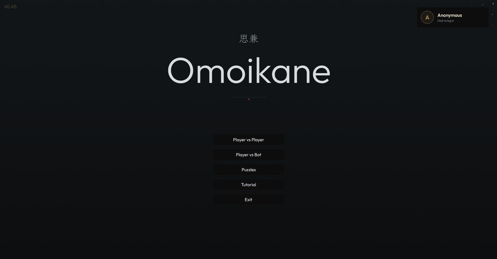

# Omoikane-Go
This project is a desktop implementation of the traditional board game **Go** written in C# using the modern cross-platform framework **Avalonia UI**.
The application is currently in **Alpha version (v0.45)**.

## 🚀 Main features
* **Local game (1v1):** Ability to play on one device against another player.
* **Play against AI (KataGo):** Integration with one of the best open-source Go engines.
* **Puzzles:** Includes tsumego problems sourced from [gogameguru/go-problems](https://github.com/gogameguru/go-problems) to sharpen your tactical skills at various difficulty levels.
* **Tutorial:** Step-by-step introduction covering core Go fundamentals (liberties, capture, two eyes, and ko rule).
* **User Profiles:** Account management allowing users to customize their profile details, upload an avatar, update their own email or password, etc.
* **Game History & Cloud Sync:** Local storage of match history using an **SQLite** database with automatic synchronization to a remote **MySQL** database via REST API.
* **Game Settings:** A curated collection of Go problems (life and death, tsumego) to sharpen your tactical skills at various difficulty levels.
    * Choice of game board size (standard 19x19, 13x13, 9x9).
    * Choice of stone color (black/white) when playing against a bot.
    * Setting the level/difficulty of the KataGo bot. 
* **Scoring:** Japanese territory scoring rules. The calculation of the final score is delegated directly to the KataGo engine.

## 🛠️ Technologies used
* **Language:** C#
* **GUI Framework:** [Avalonia UI](https://avaloniaui.net/) (XAML / MVVM)
* **Engine:** [KataGo](https://github.com/lightvector/KataGo)

---
## 📸 Screenshots
| Home | Results |
| :---: | :---: |
|  |  |
| PvE mode | PvP mode |
|  |  |

---

## 📢 Project Overview & Status

**Current Version: Alpha (v0.45)** As an early alpha release, it provides a playable experience while continuing to refine underlying systems and feature implementations.
### For developers and contributors:
You are welcome to modify, fork, or optimize this code. Please keep the following in mind:
* **All modifications and execution of the code are at your own risk.**
* Due to early-stage bugs, it is recommended to **thoroughly inspect and test** the code before deployment or further development.
* **Backend / REST API requirement:** Profile management and related data features require a connection to a REST API. You will need to host and configure your own backend instance (locally or on your own server) for these features to work. If you are interested in contributing or testing against a shared development endpoint, feel free to reach out to me directly–access may be granted on a case-by-case basis.


---
 
## ⚙️ How to start a project
1. Clone the repository.
 ```bash
git clone https://github.com/Zero89-sys/Go-BoardGame
```
2. Open the project in the IDE and run the application.

## 📄 License
Distributed under the GPL-3.0 license. See `LICENSE` for more information.